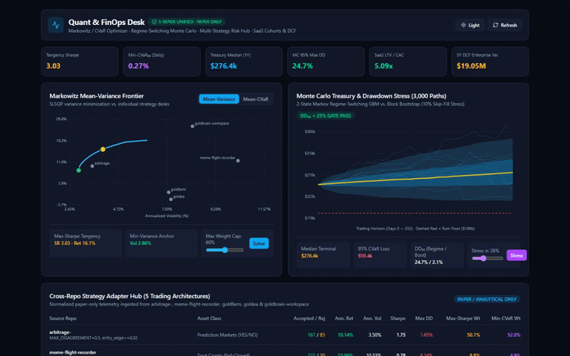
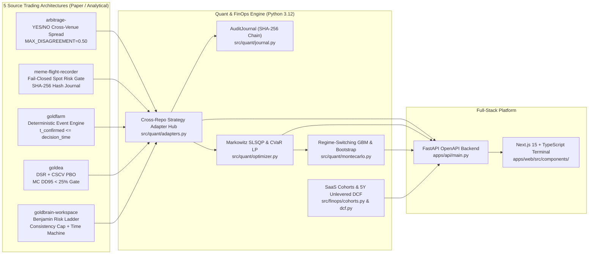
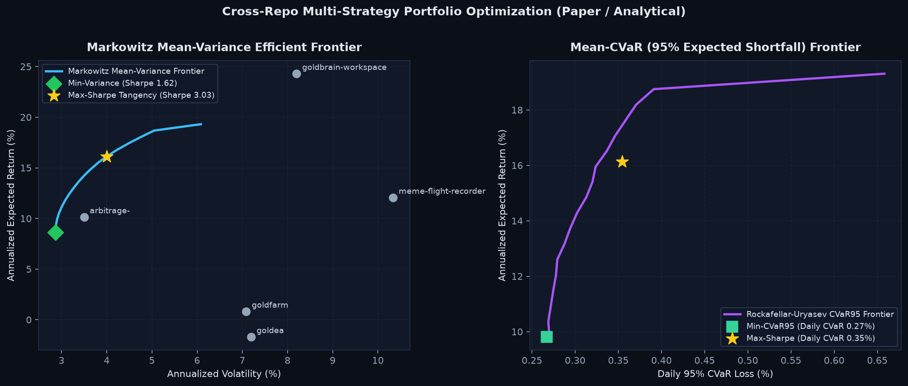
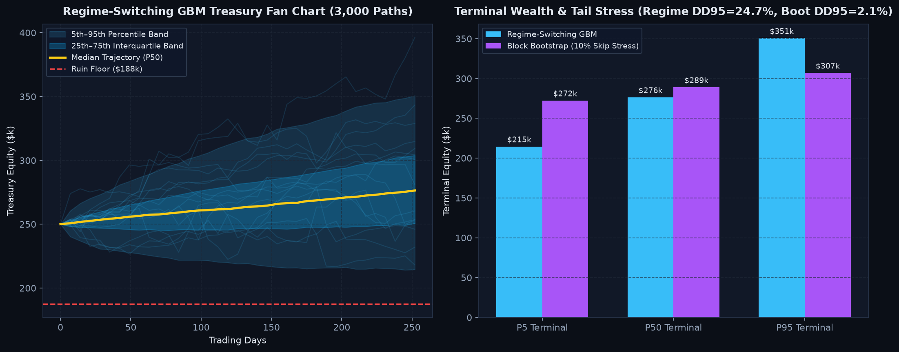
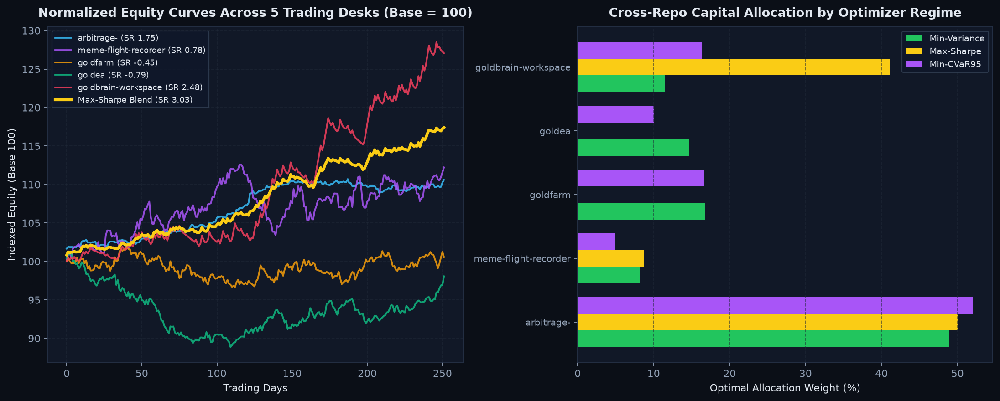
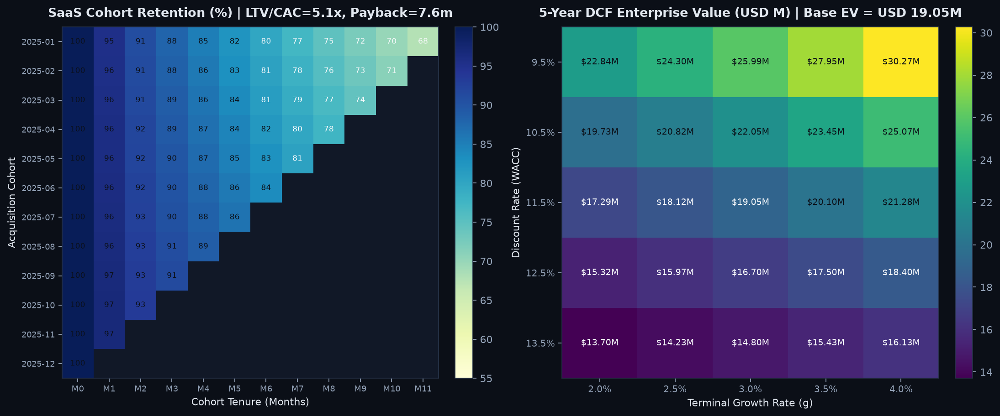
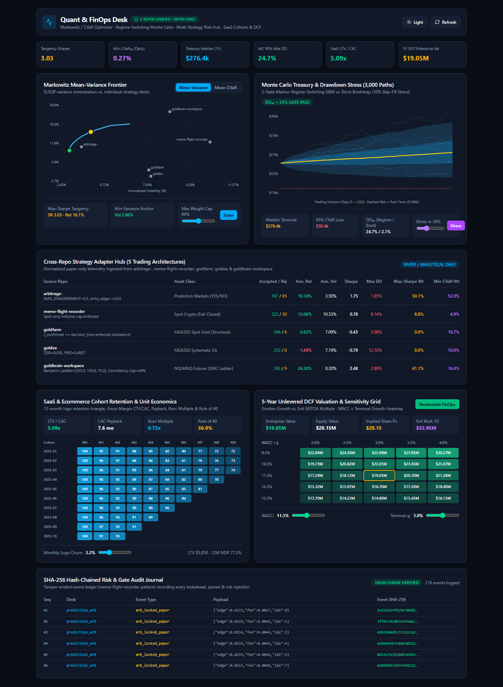
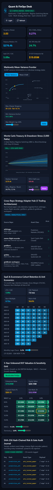

# Quant & FinOps Desk

**Unified Quantitative Multi-Strategy Risk Terminal & Corporate FinOps Valuation Platform**

[](#architecture--cross-repo-synthesis)
[](#mathematical-formulations)
[](#live-terminal-walkthrough)

> **Strictly Paper / Analytical:** Every strategy adapter, backtest evaluation, and Monte Carlo stress test in `quant-finops-desk` operates on normalized paper/analytical return streams with **zero live order routing, zero wallet signing, and zero broker credentials**.

`quant-finops-desk` synthesizes the risk gates, no-lookahead invariants, overfitting guards, and domain-specific strategy adapters from five independent trading research repositories (`arbitrage-`, `meme-flight-recorder`, `goldfarm`, `goldea`, `goldbrain-workspace`) into one institutional portfolio optimization, treasury stress-testing, and corporate FinOps (SaaS cohorts + 5-year DCF) terminal.

---

## Live Terminal Walkthrough



- **Full HD Screen Recording:** [docs/proof/dashboard-walkthrough.mp4](docs/proof/dashboard-walkthrough.mp4)
- **Desktop Capture (`1440×900`):** [docs/proof/dashboard-desktop.png](docs/proof/dashboard-desktop.png)
- **Mobile Capture (`390×844`):** [docs/proof/dashboard-mobile.png](docs/proof/dashboard-mobile.png)

---

## Architecture & Cross-Repo Synthesis



### How Each Trading Repository Feeds the Desk

| Source Repo | Core Mechanism Preserved | Enforced Invariant in `src/quant/adapters.py` |
| :--- | :--- | :--- |
| **`arbitrage-`** | Cross-venue Kalshi / Polymarket YES+NO pair pricing (`no_ask = 1 - bid`) | Rejects mismatched books with $\|p_{\text{kalshi}} - p_{\text{poly}}\| > 0.50$ (`MAX_DISAGREEMENT`) and filters spreads net of taker fees ($\text{edge} \ge 0.02$). |
| **`meme-flight-recorder`** | Fail-closed `RiskEngine` & SHA-256 hash-chained `FlightRecorder` | Enforces spot-only sizing $\min(\text{risk}/\text{stop\_pct}, \text{equity})$, missing-stop rejection, kill-switch, daily loss cap, and tamper-evident `AuditJournal`. |
| **`goldfarm`** | Deterministic market-structure event lineage (`t_formed`, `t_confirmed`) | Strictly blocks any signal with $t_{\text{confirmed}} > t_{\text{decision}}$ (zero lookahead bias) and deducts session spread, slippage, and commission. |
| **`goldea`** | Quantitative overfitting & path-perturbation validation suite | Evaluates Deflated Sharpe Ratio ($\text{DSR}$), CSCV Probability of Backtest Overfitting ($\text{PBO}$), and 15%-skip Monte Carlo ($\text{DD}_{95} < 25\%$). |
| **`goldbrain-workspace`** | Benjamin sizing ladder, consistency cap & Time Machine odds | Scales risk down a `[250, 150, 75]` loss ladder, applies $0.5\times$ Dec–Feb seasonal cut, caps days at $44\%$ consistency, and checks $P(\text{target}) \ge \frac{1}{1+R}$. |

---

## Mathematical Formulations

### 1. Markowitz Mean-Variance & Covariance Shrinkage

Given daily strategy returns $R \in \mathbb{R}^{T \times N}$ with mean vector $\hat{\mu} \in \mathbb{R}^N$, the sample covariance $\hat{\Sigma}$ is regularized toward a scaled identity matrix ($\lambda = 0.10$) to prevent ill-conditioned inversion:

$$\Sigma_{\text{shrunk}} = (1 - \lambda)\hat{\Sigma} + \lambda \frac{\operatorname{tr}(\hat{\Sigma})}{N} I_N$$

The Mean-Variance frontier solves the box-constrained quadratic program via SLSQP:

$$\min_{w \in \mathbb{R}^N} \; w^\top \Sigma_{\text{shrunk}} w \quad \text{s.t.} \quad \mathbf{1}^\top w = 1, \quad w_{\min} \le w_i \le w_{\max}, \quad 252 \cdot \hat{\mu}^\top w \ge \mu_{\text{target}}$$

### 2. Rockafellar-Uryasev (2000) CVaR Linear Program

Because variance penalizes upside volatility symmetrically, `PortfolioOptimizer.solve_min_cvar()` solves the exact convex linear program over scenarios $s \in \{1,\dots,S\}$ using the HiGHS simplex/interior-point solver:

$$\min_{w, \zeta, u \ge 0} \; \zeta + \frac{1}{(1-\alpha)S} \sum_{s=1}^{S} u_s \quad \text{s.t.} \quad u_s \ge -r_s^\top w - \zeta, \quad \mathbf{1}^\top w = 1, \quad 252 \cdot \hat{\mu}^\top w \ge \mu_{\text{target}}$$

At optimality, $\zeta^* = \operatorname{VaR}_\alpha(w^*)$ and the objective equals $\operatorname{CVaR}_\alpha(w^*)$ (Expected Shortfall).

### 3. Regime-Switching Monte Carlo Treasury Stress

Treasury equity $E_t$ evolves under a 2-state Markov chain $S_t \in \{\text{Calm}, \text{Stress}\}$ with transition matrix $P$:

$$E_{t+1} = E_t \exp\!\left[\left(\mu_{S_t} - \tfrac{1}{2}\sigma_{S_t}^2\right)\Delta t + \sigma_{S_t}\sqrt{\Delta t}\, Z_t\right], \quad Z_t \sim \mathcal{N}(0, 1), \quad \Delta t = \frac{1}{252}$$

alongside a circular empirical block-bootstrap with execution skip-fill stress ($p_{\text{skip}} = 10\%$).

### 4. Deflated Sharpe Ratio (DSR) & CSCV PBO

Following Bailey & López de Prado (2014), the non-annualized Sharpe $\widehat{\text{SR}}$ across $T$ observations and $N_{\text{trials}}$ trials is deflated against expected maximum noise Sharpe $\text{SR}_0$:

$$\text{DSR} = \Phi\!\left(\frac{(\widehat{\text{SR}} - \text{SR}_0)\sqrt{T-1}}{\sqrt{1 - \hat{\gamma}_3 \widehat{\text{SR}} + \frac{\hat{\gamma}_4 - 1}{4}\widehat{\text{SR}}^2}}\right)$$

### 5. Corporate FinOps: SaaS Cohorts & 5-Year Unlevered DCF

- **Gross-Margin LTV & Payback:**
  $$\text{LTV} = \frac{\text{ARPA} \times \text{GM}}{\max(0.005,\, c_{\text{logo}} - 0.5 e_{\text{exp}})}, \qquad \text{Payback (mo)} = \frac{\text{CAC}}{\text{ARPA} \times \text{GM}}$$
- **Unlevered Free Cash Flow & Gordon Growth Terminal Value:**
  $$\text{UFCF}_t = \text{EBIT}_t(1 - \tau) + \text{D\&A}_t - \text{CapEx}_t - \Delta\text{NWC}_t, \qquad \text{EV} = \sum_{t=1}^{5} \frac{\text{UFCF}_t}{(1+\text{WACC})^t} + \frac{\text{UFCF}_5(1+g)}{(\text{WACC}-g)(1+\text{WACC})^5}$$

---

## Observed Quantitative Proof & Visualizations

All metrics below are **directly computed from our seeded paper-analytical run (`seed=42, T=252` trading days)** via [`scripts/generate_proof_plots.py`](scripts/generate_proof_plots.py).

### Multi-Strategy Efficient Frontiers (Markowitz & CVaR₉₅)



- **Min-Variance Portfolio:** Annualized Return `8.64%`, Volatility `2.86%`, Sharpe `1.62`, Daily CVaR₉₅ `0.28%`
- **Max-Sharpe Tangency Portfolio:** Annualized Return `16.13%`, Volatility `4.00%`, Sharpe `3.03`, Daily CVaR₉₅ `0.35%`
- **Min-CVaR₉₅ Portfolio:** Annualized Return `9.81%`, Volatility `2.92%`, Sharpe `1.99`, Daily CVaR₉₅ `0.27%`

### Regime-Switching & Block-Bootstrap Monte Carlo Treasury Stress



- **Regime-Switching GBM (3,000 paths, $250k start):** Median Terminal `$276,401.87`, P5 `$214,565.97`, P95 `$350,709.96`, 95% CVaR Loss `$50,388.45`, 95th-Pct Max Drawdown `24.70%` (`passes_dd95_gate = True`), Ruin Prob (`< $187.5k`) `2.13%`.
- **Empirical Block-Bootstrap + 10% Skip-Fill Stress (3,000 paths):** Median Terminal `$289,008.70`, P5 `$272,357.54`, 95th-Pct Max Drawdown `2.08%`, Ruin Prob `0.00%`.

### Cross-Repo Strategy Attribution & Capital Allocation



### Corporate FinOps: Cohort Retention & 5-Year DCF Sensitivity



- **SaaS Unit Economics:** LTV `$5,850.00`, CAC `$1,150.00`, **LTV/CAC `5.09x`**, CAC Payback `7.56 months`, Burn Multiple `0.72x`, Rule of 40 `56.0%`.
- **5-Year DCF Valuation (`WACC = 11.5%`, `g = 3.0%`):** Enterprise Value **`$19,049,459.37`**, Equity Value **`$20,149,459.37`**, Implied Share Price `$20.15`, Exit EBITDA (`14.0x`) EV `$32,951,787.46`.

### Live Desktop & Mobile Terminal Captures

<table>
  <tr>
    <td><strong>Desktop Terminal (1440×900)</strong></td>
    <td><strong>Mobile Terminal (390×844)</strong></td>
  </tr>
  <tr>
    <td></td>
    <td></td>
  </tr>
</table>

---

## Tools, Skills, AI & Quant Stack

- **Quantitative Optimization & Numerics:** Python 3.12, `numpy` (vectorized Monte Carlo & covariance shrinkage), `scipy.optimize` (`SLSQP` quadratic programming + `HiGHS` linear programming for Rockafellar-Uryasev CVaR), `scipy.stats` (non-normal skewness/kurtosis adjustments for DSR), `pandas`, `matplotlib` (160-DPI dark-terminal analytical figures).
- **Backend & Data Contracts:** FastAPI (`apps/api/main.py`), Pydantic v2 (`apps/api/schemas.py`), Uvicorn ASGI, SHA-256 canonical JSON hash-chaining (`src/quant/journal.py`).
- **Frontend & Interactive Visualization:** Next.js 15 (App Router), React 19, TypeScript (strict mode), Tailwind CSS v4, custom responsive SVG charts (frontier curves, quantile fan bands, heatmaps), Lucide icons.
- **Verification & Browser Automation:** `pytest` (18 invariant/API tests), `ruff`, `mypy`, `tsc --noEmit`, `eslint`, `vitest` + React Testing Library (2 component tests), Playwright (headless Chromium DOM & overflow assertions + video recording), `ffmpeg` (H.264 MP4 + Lanczos palette GIF).

---

## Quickstart

### 1. Run Python Quant Engine, Tests & FastAPI Backend

```bash
pip install -e ".[dev]"
pytest -v
ruff check src apps tests
mypy src apps
uvicorn apps.api.main:app --host 127.0.0.1 --port 8000
```

### 2. Run Next.js Interactive Dashboard

```bash
cd apps/web
npm install
npm run typecheck && npm run lint && npm test && npm run build
npm run start
```

Open `http://127.0.0.1:3000` (with FastAPI running on `:8000` or configured via `NEXT_PUBLIC_API_URL`).

---

## Further Documentation

- [Engineering & Quantitative Case Study](docs/CASE_STUDY.md)
- [Verification & Proof-of-Work Ledger](docs/PROOF_OF_WORK.md)
